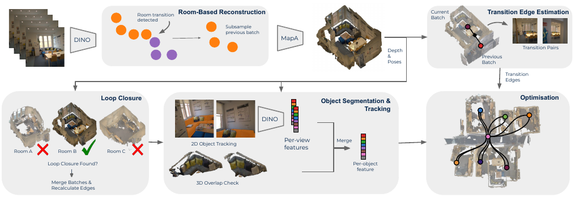

# LEXI-SG

**LEXI-SG: Monocular 3D Scene Graph Mapping with Room-Guided Feed-Forward Reconstruction**

Christina Kassab, Hyeonjae Gil, Matias Mattamala, Ayoung Kim, Maurice Fallon

[Project page](https://ori-drs.github.io/lexisg-web/) · [Paper](https://doi.org/10.1109/LRA.2026.3717257)



LEXI-SG builds a room-level 3D scene graph from a monocular RGB image
sequence. Frames are grouped into rooms as they arrive, each room is
reconstructed with MapAnything, revisited rooms are merged by loop closure, the
room graph is optimised, and objects are segmented within each room.

## Getting started

### 1. Clone the repository

```sh
mkdir -p lexi-sg_ws/src && cd lexi-sg_ws/src
git clone https://github.com/ori-drs/lexi-sg.git
cd lexi-sg
```

The `lexi-sg_ws/` workspace layout is the one the Docker setup expects (see
step 2); it is optional for the pip installation.

### 2. Install

Tested with CUDA 12.8, Python 3.11 and PyTorch 2.10.0+cu128. Other
CUDA-capable GPUs work with a matching PyTorch build. Follow one of the two
methods below.

**Option A: pip and a virtual environment.** Requires Python 3.11
(`sudo apt install python3.11 python3.11-venv` on Debian/Ubuntu). From the
repository root:

```sh
bash scripts/setup_env.sh
source .venv/bin/activate
```

The script creates the environment, installs a CUDA-matched PyTorch build and
the dependencies in `docker/requirements.lexisg.txt`, clones the third-party
repositories (`scripts/clone_thirdparty.sh`) and builds the GroundingDINO
CUDA extension, which needs the CUDA toolkit (`nvcc`); tested with CUDA 12.8.

**Option B: Docker.** The Compose file expects this workspace layout:

```
lexi-sg_ws/
├── src/lexi-sg/          # this repository
│   └── checkpoints/      # model weights (step 3)
├── data/                 # datasets, mounted at /workspace/datasets
└── .cache/               # HuggingFace, torch and conda caches
```

Create the mounted folders before the first `docker compose up`; otherwise
Docker creates them owned by root. Then clone the third-party repositories,
which the image is built from, and start the container:

```sh
mkdir -p ../../data ../../.cache/conda-pkgs checkpoints
bash scripts/clone_thirdparty.sh
cd docker
docker compose build
docker compose up -d
docker compose exec -it lexisg bash
```

Inside the container the repository is at `/workspace/lexi-sg`. The container
(`lexisg-dev`) runs as root by default; export
`USER_UID=$(id -u) USER_GID=$(id -g)` before `docker compose up` to have
generated files owned by your user.

**Third-party repositories.** `scripts/clone_thirdparty.sh` clones these into
`thirdparty/`, each pinned to a tested commit:

| Repository | Used for |
|---|---|
| [map-anything](https://github.com/facebookresearch/map-anything) | Reconstruction |
| [Grounded-Segment-Anything](https://github.com/IDEA-Research/Grounded-Segment-Anything) | GroundingDINO detection and SAM masks |
| [recognize-anything](https://github.com/HyeonJaeGil/recognize-anything) | RAM image tagging |
| [sam2](https://github.com/HyeonJaeGil/sam2) | Object mask tracking |
| [openlex3d](https://github.com/HyeonJaeGil/openlex3d) | OpenLex3D benchmark tools |

**Check the installation:**

```sh
python -c "import lexisg, torch; print(torch.__version__, torch.cuda.is_available())"
python scripts/check_grounding_dino_cuda.py
```

### 3. Download the model checkpoints

```sh
bash scripts/fetch_checkpoints.sh
```

This downloads GroundingDINO and RAM into `checkpoints/`. The DINOv3 weights
are gated behind Meta's licence: accept it at the
[DINOv3 download page](https://ai.meta.com/resources/models-and-libraries/dinov3-downloads/),
then download the two files the script lists into `checkpoints/`. The four
files must keep these names:

```
checkpoints/
├── groundingdino_swint_ogc.pth
├── ram_swin_large_14m.pth
├── dinov3_vitl16_pretrain_lvd1689m-8aa4cbdd.pth
└── dinov3_vitl16_dinotxt_vision_head_and_text_encoder-a442d8f5.pth
```

MapAnything and its image encoder are downloaded automatically on the first
run, so the first run needs internet access.

### 4. Download the data

**Aria Office Dataset (AOD).** Download the sequences from the
[AOD Google Drive folder](https://drive.google.com/drive/folders/1fVULvxCCZbyEoWk4AUQnL96q0iUGmUXs?usp=drive_link)
and unzip them so that each sequence is a folder under `data/aod/`:

```
lexi-sg_ws/data/aod/
├── ff-1/                 # Floor 1, sequences ff-1 .. ff-3
│   └── rgb/
├── ...
└── gf-3/                 # Ground floor, sequences gf-1 .. gf-3
```

**HM3D.** The seven HM3DSem-Walks scenes are distributed by
[OpenLex3D](https://openlex3d.github.io):

```sh
mkdir -p lexi-sg_ws/data/hm3d && cd lexi-sg_ws/data/hm3d
for s in 00824 00829 00843 00847 00873 00877 00890; do
    wget http://aisdatasets.cs.uni-freiburg.de/openlex3d/hm3d/$s.zip
    unzip -q $s.zip -d $s && rm $s.zip
done
```

Only `rgb/` is required to run the pipeline; the other folders in each scene
are not used by default.

### 5. Run the pipeline

Inside the Docker container, the dataset configs work as they are:

```sh
python main.py --config config/datasets/aod.yaml
python main.py --config config/datasets/hm3d.yaml
```

Each config points at one sequence (`aod/ff-1`, `hm3d/00824`). Select another
sequence, or paths outside Docker, with `--set`, which overrides any config
value:

```sh
python main.py --config config/datasets/aod.yaml \
    --set data_path=/path/to/data/aod/gf-2 \
    --set output_folder=/path/to/output/gf-2
```

**`output_folder` is deleted and recreated at the start of every run.** Use a
separate folder per run to keep earlier results.

Object segmentation is the slowest stage. To reconstruct and build the room
graph only, add `--set object_segmentation.enabled=false`.

On a GPU with 16 GB of memory, use `config/datasets/aod_16gb.yaml` for AOD.
The default configs run in 24 GB and above. To run on a specific GPU, add
`--set model_devices.reconstruction=1 --set model_devices.semantic=1`.

### 6. Visualise the result

Add `--visualise` to write a [Rerun](https://rerun.io) recording at the end of
the run, then open it:

```sh
python main.py --config config/datasets/aod.yaml --visualise
rerun /workspace/lexi-sg/output/scene_graph.rrd
```

A recording can also be written from an existing output folder; `--spawn`
opens the viewer directly:

```sh
python visualise.py --output-dir /workspace/lexi-sg/output --spawn
```

The scene is shown as stacked layers: the room graph, the trajectory, the
object-segmented cloud (when present) and the full reconstruction.

## Output

```
output/
├── full_pcd.pcd                   # Point cloud of all rooms
├── segmented_pcd.pcd              # Object-segmented point cloud
├── pose.txt                       # Camera trajectory: frame x y z qx qy qz qw
├── scene_graph.rrd                # Rerun recording (with --visualise)
├── original/                      # One point cloud per room or corridor
│   ├── room_0.pcd
│   ├── corridor_1.pcd
│   └── ...
└── object_segmentation/           # Per-room object segmentation results
    └── room_0000/
```

Point clouds and poses are saved floor-aligned: +Z points up and the floor is
at z = 0. `segmented_pcd.pcd` and `object_segmentation/` are only written when
object segmentation is enabled. With `object_segmentation.cross_room.enabled:
true`, objects in neighbouring rooms are also associated, which adds
`segmented_pcd_rooms.pcd`, `segmented_pcd_cross_room.pcd` and
`cross_room_objects.json`.

## Using your own data

The pipeline needs only a sequence of RGB images from a single camera moving
through a building.

1. **Prepare the frames.** Put the images in an `rgb/` folder. Frames are
   processed in filename order. From a video:

   ```sh
   mkdir -p my_sequence/rgb
   ffmpeg -i video.mp4 -vf fps=5 my_sequence/rgb/frame_%06d.jpg
   ```

   Choose the frame rate so that consecutive frames overlap substantially.
   Large gaps between frames weaken both reconstruction and loop closure.

2. **Create a config.** Copy the closest dataset config:
   `aod.yaml` for offices and buildings with corridors, or `hm3d.yaml` for
   homes. Then set `data_path` to your sequence folder and `output_folder` to
   where the results should go.

3. **Adjust the room segmentation prompts** (see below) to the room types in
   your environment.

4. **Optionally add depth and poses.** If your camera provides depth maps or
   poses, they improve reconstruction accuracy substantially; see
   [Depth and pose inputs](#depth-and-pose-inputs).

5. **Run** with `python main.py --config path/to/your_config.yaml`.

## Configuration

Dataset configs are in `config/datasets/`; any value can be overridden with
`--set key.subkey=value`. The parameters most worth adjusting:

| Parameter | Effect |
|---|---|
| `room_segmentation.room_prompt_list` | Room types in the environment, plus the transition type |
| `room_segmentation.method` | Transition between rooms (`corridor` or `doorway`); must be in the prompt list |
| `room_segmentation.enter_threshold` | Higher: fewer, longer room segments |
| `reconstruction.batch_size` | Maximum frames per room passed to MapAnything, evenly subsampled |
| `loop_closure.room_threshold`, `num_matches`, `iou_threshold` | Higher: fewer rooms merged as revisits |
| `object_segmentation.enabled` | `false` skips object segmentation, the slowest stage |
| `model_devices.reconstruction`, `semantic` | GPU indices, to split the models across GPUs |

Each frame is labelled with its best-matching prompt; only whether that label
is the transition type is used, and the other prompts act as alternatives.
Loop closure is sensitive to its thresholds on some sequences, since one merge
can change the whole trajectory.

### Depth and pose inputs

MapAnything reconstructs from RGB alone by default. Depth maps and camera
poses, if available, improve accuracy substantially. Place them next to
`rgb/`, one file per frame, sorted in the same order:

- `depth/`: images (e.g. 16-bit PNG); value ÷ `depth_scale` gives metres.
- `pose/`: one `.txt` per frame holding a 4x4 (or 3x4) camera-to-world matrix,
  row-major.

Then enable them in the config:

```yaml
inputs:
  depth: true
  poses: true
  depth_scale: 1000.0
  intrinsics: [fx, fy, cx, cy]     # required with depth
  pose_convention: opencv          # opengl for +Y up, -Z forward cameras (e.g. Habitat)
  poses_are_world_to_cam: false
```

Object segmentation parameters are in `config/object_segmentation/service.yaml`
and described in `config/object_segmentation/reference.md`.

## Repository structure

```
lexi-sg/
├── main.py                        # End-to-end pipeline: reconstruction, room segmentation,
│                                  # loop closure, optimisation and object segmentation
├── visualise.py                   # Rerun visualisation
├── config/
│   ├── datasets/                  # Dataset configs (aod.yaml, aod_16gb.yaml, hm3d.yaml)
│   └── object_segmentation/       # Object segmentation configs
├── lexisg/                        # Python package
│   ├── models/                    # MapAnything, DINOv3 and detection/tracking models
│   ├── structures/                # Graph, node and edge data structures
│   ├── tasks/
│   │   ├── room_segmentation.py   # Room boundary detection and batching
│   │   ├── loop_closure.py        # Room revisit detection and merging
│   │   ├── optimiser.py           # Room graph optimisation
│   │   ├── visualiser.py          # Output export
│   │   └── object_segmentation/   # Object segmentation stages
│   └── utils/                     # Config loading, data loaders, geometry
├── scripts/                       # Setup, checkpoint download and helper scripts
├── docker/                        # Dockerfile, Compose file and entrypoint
└── docs/                          # README figures
```

## License

This project is released under the [GNU GPL v3.0](./LICENSE).
For third-party dependency licenses, refer to the repositories and packages in `thirdparty/` and the [Getting started](#getting-started) section.
For commercial purposes, please contact the authors.

## Citation

```bibtex
@article{kassab2026lexisg,
  title   = {LEXI-SG: Monocular 3D Scene Graph Mapping with Room-Guided Feed-Forward Reconstruction},
  author  = {Kassab, Christina and Gil, Hyeonjae and Mattamala, Matias and Kim, Ayoung and Fallon, Maurice},
  journal = {IEEE Robotics and Automation Letters},
  volume  = {11},
  number  = {9},
  pages   = {10839--10846},
  year    = {2026},
  doi     = {10.1109/LRA.2026.3717257},
}
```
